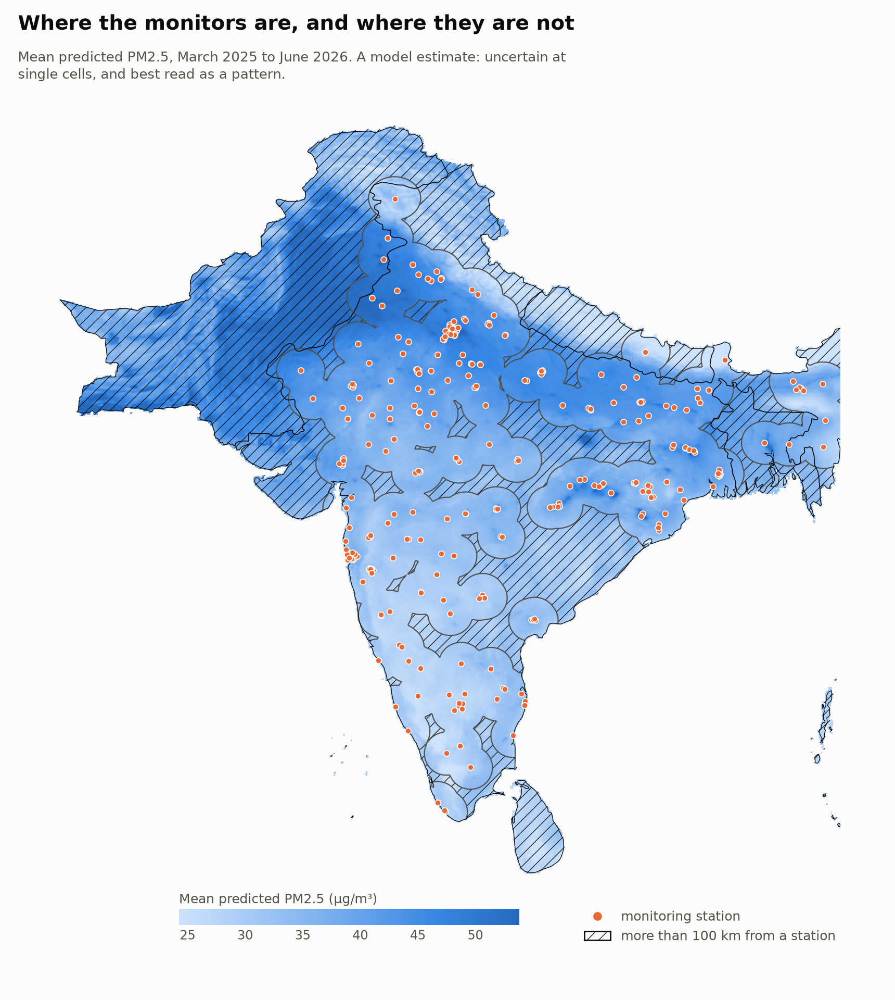
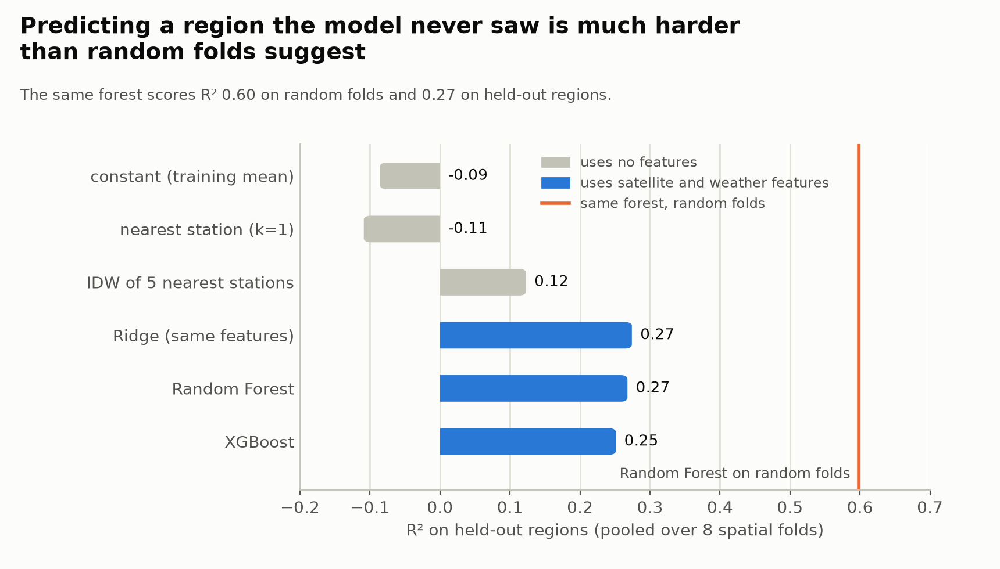
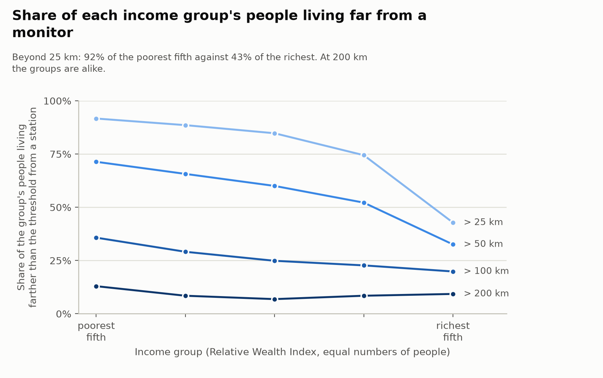
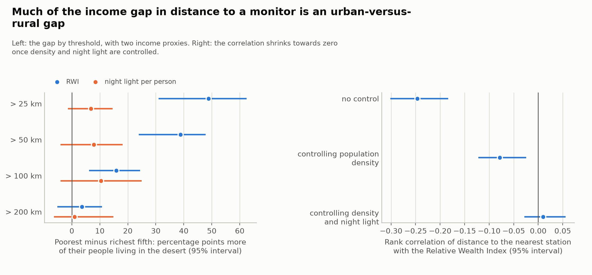
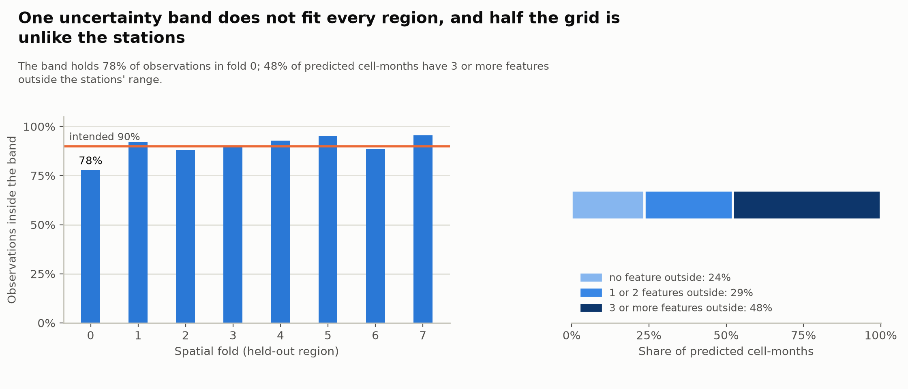

# Monitoring deserts

**Where are air-quality monitors scarce in South Asia, and are those gaps concentrated among the poor?** A machine-learning pipeline that predicts PM2.5 where there is no station, checks that prediction the hard way (by holding out whole regions), and uses it to map the "monitoring deserts" and ask who lives in them.

[](https://github.com/tisolab/monitoring-deserts/actions/workflows/tests.yml)

[](LICENSE)

**[Project page](https://tisolab.github.io/monitoring-deserts/)** · **[Interactive map](https://tisolab.github.io/monitoring-deserts/map.html)** · **[Write-up](reports/writeup.md)** · **[Methodology notes](docs/methodology/)** · **[Pipeline](docs/pipeline.md)** · **[Known issues](docs/known_issues.md)**



## What it finds

Numbers are from the saved outputs in `configs/` (collected in [`reports/key_numbers.yaml`](reports/key_numbers.yaml)); the study period is March 2025 to June 2026, with 343 OpenAQ stations (5,222 station-months).

1. **Monitors are sparse compared with where people live.** The median populated grid cell is about 91 km from the nearest station. Of the people in cells with population data, 56% live more than 50 km from a station and 27% more than 100 km. Over the five study countries, 45% of the land area is more than 100 km from a station.
2. **Predicting a region the model has never seen is much harder than ordinary cross-validation suggests.** The same Random Forest scores $R^2 = 0.60$ on random folds and $R^2 = 0.27$ when whole regions are held out (RMSE 27 µg/m³, MAE 16 µg/m³ pooled). A project that reported the random-fold number would have overstated its skill by more than a factor of two.
3. **The features carry real information, and a simple model is enough.** Satellite and weather features beat inverse-distance interpolation of the nearest stations (paired test over the eight folds, $t = -3.4$). A Ridge regression, a Random Forest and XGBoost are statistically tied, so the simplest, Ridge, is the definitive model. Most of its skill is meteorological and seasonal; the satellite NO2 and aerosol-index terms add comparatively little.
4. **The poorest people are more often far from a monitor, but much of that is urban versus rural.** Beyond 25 km from a station live 92% of the poorest fifth (by the Relative Wealth Index) against 43% of the richest fifth; at 100 km the figures are 36% and 20%, and at 200 km the groups are not distinguishable. The rank correlation between distance to a station and wealth is −0.25, falls to −0.08 after controlling for population density, and to 0.01 after controlling for density and night-time light. A second income proxy gives gaps of the same sign with intervals that include zero.
5. **Where a new monitor would cover the most exposure** is ranked over 0.5° zones in the desert and listed on the [interactive map](https://tisolab.github.io/monitoring-deserts/map.html) (exposure = predicted PM2.5 × population). The ranking is dominated by population and is stable across the lower and upper bounds of the uncertainty band.
6. **Sanity checks pass, with one clear exception.** The predicted national seasonal cycle follows the observed one (correlation 0.98 over 16 months), and nine of ten spot-checked places behave as expected (Delhi and Lahore in the top 2% of populated cells, Munnar and Nuwara Eliya in the bottom 2%). The high-altitude town of Leh does not: the model has no elevation feature.

## Figures









## How it works

1. **Ground truth.** Monthly PM2.5 at 343 OpenAQ stations ([`noteboox/01`–`02`](noteboox/)).
2. **Features.** Tropospheric NO2 and the absorbing aerosol index from Sentinel-5P (Earth Engine), ERA5 weather, and the month as a cycle; the same features are built for every 0.05° cell of a 435,000-cell grid (`03`–`06`, `10`).
3. **Spatial cross-validation.** Stations are clustered into 35 spatial blocks packed into 8 folds, so a whole region is held out together; the folds are checked against the distances at which the model will actually be used (`08`; [why](docs/methodology/spatial_cv.md)).
4. **Models and baselines.** A constant, nearest-station and inverse-distance interpolation, Ridge, Random Forest and XGBoost, all tuned on the spatial folds and compared with paired tests (`09`; [why Ridge](docs/methodology/ridge_regression.md)).
5. **Prediction with uncertainty.** A prediction for every cell and month, with a residual band and two warning indicators (disagreement with the forest, and the number of features outside the stations' range) (`11`; [the strategies](docs/methodology/uncertainty.md)).
6. **Deserts and equity.** Distance to the nearest station at several thresholds; population-weighted income groups; block-bootstrap intervals that respect spatial correlation (`12`–`13`).
7. **Validation and limits.** Seasonal cycle, spot checks, and the range over which the model was validated (`14`).

The full phase-by-phase table, with the code and outputs of each stage, is in [`docs/pipeline.md`](docs/pipeline.md).

## Repository layout

```
noteboox/        the 14 notebooks, run in order
src/monitoring_deserts/
  data/          OpenAQ, Earth Engine, ERA5, WorldPop/RWI and boundary downloaders
  models/        spatial cross-validation, baselines, prediction helpers
  features/      desert and equity statistics
  viz/           the report figures and the interactive map
configs/         project settings and one metadata file per stage (settings and headline numbers)
scripts/         make_report_assets.py: figures, key numbers and the web map
tests/           pytest suite for the source modules (synthetic data, no network)
reports/         the write-up, the figures and key_numbers.yaml
docs/            the GitHub Pages site (summary page and map), the pipeline table, the methodology notes and known issues
data/            not in git; layout described in data/README.md
```

## Reproduce

```bash
conda env create -f environment.yml          # Python 3.11 and every dependency (also installs the package)
conda activate mon-des
cp .env.example .env                         # then fill in the three keys (see below)
pytest                                       # the source modules, on synthetic data
jupyter lab                                  # run noteboox/01 ... 14 in order
python scripts/make_report_assets.py         # rebuild reports/figures, key_numbers.yaml and the pages in docs/
```

Keys in `.env`: `OPENAQ_API_KEY` (free, from OpenAQ), `GEE_PROJECT_ID` (a Google Cloud project registered for Earth Engine, and `ee.Authenticate()` once), and `CARTODB_API_KEY` if used. ERA5 needs a Copernicus Climate Data Store account (`~/.cdsapirc`). The notebooks download the data into `data/`; the first full run is dominated by the Earth Engine and ERA5 requests. Settings (study period, bounding box, grid size, paths) are in `configs/`.

## Data and licences

The code is MIT-licensed ([LICENSE](LICENSE)). **No data is redistributed**: every dataset is downloaded from its provider, under its own terms, which you should check before reuse.

| Data | Source | Terms |
|---|---|---|
| PM2.5 at ground stations | [OpenAQ](https://openaq.org) v3 | open data; licence depends on the data provider |
| NO2 and aerosol index | Copernicus Sentinel-5P TROPOMI, via Google Earth Engine | free and open (Copernicus) |
| Weather | ERA5 monthly reanalysis, Copernicus Climate Data Store | Copernicus licence, attribution required |
| Population | [WorldPop](https://www.worldpop.org) 2020, 1 km, UN-adjusted | CC BY 4.0 |
| Relative Wealth Index | Meta / Berkeley, via the Humanitarian Data Exchange | **CC BY-NC 4.0: non-commercial** |
| Night-time light | VIIRS annual composite, NOAA / Earth Observation Group | free with attribution |
| Country boundaries | [Natural Earth](https://www.naturalearthdata.com) | public domain |

The Relative Wealth Index is non-commercial, so the equity results that depend on it (notebook 13 and the figures built from it) are for research and portfolio use, not for commercial reuse.

## Limitations

- **Stations are not placed at random.** They are in towns where pollution is a concern, so they may not represent the unmonitored areas; the model is applied to cells unlike them (48% of predicted cell-months have three or more features outside the stations' range).
- **Skill is modest and uneven.** $R^2 = 0.27$ on held-out regions, and below zero in the most polluted fold (which includes the Delhi region). Predictions of high values are compressed, so statements about the most polluted places are about rank, not level.
- **The uncertainty band is one width everywhere** and is not a calibrated interval; it holds 78% of observations in the worst fold against an intended 90%.
- **The validated distance is shorter than the distances predicted over.** Cross-validation tests transfer at about 90 to 230 km from the nearest training station; populated cells have a median of 91 km and a 90th percentile of 375 km.
- **Columns, not the surface.** TROPOMI measures atmospheric columns; the link to ground-level concentration depends on boundary-layer physics the model only approximates.
- **The income measures are proxies**, and the equity result is an association over 16 months, not a cause.
- **Sixteen months** (March to June appear twice), and a grid that stops at 93.4°E.

More in the [write-up](reports/writeup.md) and in [docs/known_issues.md](docs/known_issues.md).

## Author

Tommaso Isolabella. Built as a portfolio project; questions and corrections are welcome as issues.
